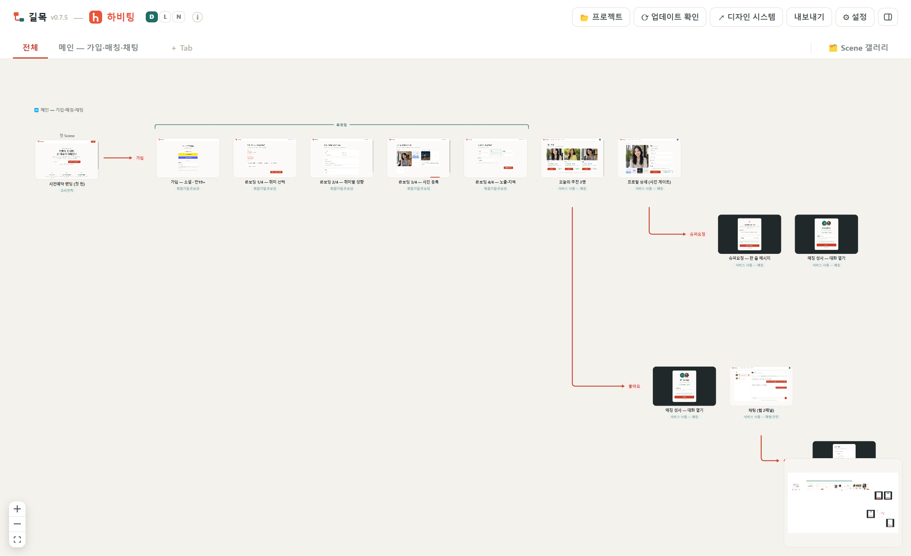

# 사용법

## 용어

| 용어 | 의미 |
|---|---|
| **Scene** | 화면 하나 (HTML 프리뷰 카드 — 또는 캡처 이미지) |
| **Tab** | 독립 플로우 한 벌 — 상단 탭으로 전환, '전체'는 모든 Tab 한눈에 |
| **Branch** | 한 Scene에서 갈라져 나가는 분기 라인 (빨간 트렁크 + 라벨) |
| **Bracket** | 연속 구간을 ⌐¬ 로 묶는 범주 (예: 온보딩) |

UI는 한국어 + 도메인 명사만 영어를 쓴다.

## 보기

- **카드 클릭** = 앱 안 뷰어로 열기. **‹ › 버튼 또는 ← →** 로 **그 라인(Branch) 안에서만** 앞뒤 Scene으로 넘김(끝에서 멈춤), Esc 닫기. 첫 Scene 카드는 루트 + 첫 Branch, 갤러리 카드는 같은 그룹 순서. 실물 크기 새 창은 뷰어의 '↗ 새 창'
- **휠** = 이동 · **Ctrl+휠** = 확대/축소 · **스페이스+드래그** = 화면 이동
- 썸네일 우상단 **D/L/N** = Scene 테마 전환(기본/라이트/다크), 헤더의 D/L/N은 전체 일괄 전환
- 우하단 **미니맵** = 실사 썸네일로 전체 조망
- 헤더 **ⓘ** 아이콘에 마우스를 올리면 요약 도움말

## 편집 (모두 Ctrl+Z 가능, flow.json 자동 저장)

- **카드 드래그** = 순서 이동 — 같은 Branch 안에서도, 다른 Branch로도
- **＋** = Scene 삽입 · 카드 호버 **⑂ Branch** = 분기 추가 · **✕** = 삭제
- **라벨·Bracket 이름 클릭** = 그 자리에서 수정
- **Shift+드래그로 선택 → 우클릭** = Bracket으로 묶기, Bracket 끝 핸들 드래그 = 범위 조절
- 카드 호버 **Add note** = 노트 붙이기

## Branch 자유 배치

- **Branch 라벨을 드래그**하면 그 Branch와 뒤따르는 모든 하위 분기·Scene이 **블록 통째로** 움직인다.
- 다른 Branch 영역과 겹치면 **블록 전체를 감싸는 빨간 박스**로 불가 표시 — 그 상태로 놓으면 원위치.
- 라벨을 **다른 Scene 위에 놓으면 재앵커**(분기 시작점 변경). 첫 번째 Branch는 구조 보호를 위해 이동만 가능.
- 배치는 `flow.json`의 `layout` 오프셋으로 저장된다.
- 같은 Scene이 한 Tab의 여러 Branch에 나오면(예: 여러 경로가 모두 '매칭 성사'로 이어질 때) 그 Scene에서 갈라지는 Branch는 **처음 나온 카드에만** 그린다. 다시 나온 카드에는 **⑂ Branch N개는 첫 등장 카드에 ↗** 표시가 붙고, 누르면 그 카드로 이동한다.

## 새 창 — 프로젝트 나란히 보기

**Ctrl+Shift+N**(macOS는 Cmd+Shift+N) 또는 📂 프로젝트 메뉴의 **⧉ 새 창**으로 길목을 하나 더 띄운다. 새 창은 별도 프로세스라 📂 메뉴에서 다른 프로젝트를 열어도 원래 창에 영향이 없고, 내장 터미널과 파일 감시도 창마다 따로 돈다. 같은 프로젝트를 두 창에서 열면 한쪽의 저장이 다른 쪽에 자동 반영된다.

## Scene 갤러리

우측 상단 **🗂️ Scene 갤러리** — 전체 Scene을 그룹(카테고리)별 썸네일 카탈로그로 본다. `scenes.<id>.group`으로 그룹을 지정한다.

## 버전별 플로우 (v0.8.0+) — 브랜치 트리 (v0.9.0+)

헤더 **⎇ 버전**으로 시작한다 — 지금 플로우를 기준 버전(예: 1.0)으로 삼고 그 위에 버전을 쌓는다. 버전은 **git처럼 트리**라서 어느 버전에서든 갈라져 나갈 수 있다(예: 1.0에서 `A안`·`B안`을 나란히 만들고 각각 따로 다듬기).

- **버전을 고른 상태에서 편집**하면 그 버전에만 기록된다. 바뀌지 않은 Scene·Tab은 **부모 쪽(루트까지의 경로) 것을 그대로 상속**한다. **형제 갈래의 변경은 보이지 않는다.**
- Tab 구조(Branch·순서·Bracket·배치)는 그 Tab을 건드리는 순간 Tab 단위로 복사돼 그 버전에서만 바뀐다 — 버전마다 플로우 자체가 달라도 된다.
- 값을 부모 버전과 같게 되돌리면 기록이 자동으로 사라진다(상속 복귀).
- 카드 호버 **⎇ v<버전>용** = 같은 폴더에 `<이름>@<버전>.html` 사본을 만들고 그 버전의 Scene이 사본을 가리키게 한다(상대 경로 자산 유지). 사본만 고치면 그 버전에만 반영된다. 데스크톱 앱(Electron)에서만 동작.
- **버전 메뉴(⎇ v… ▾)** = 트리로 표시된다(들여쓰기·가지선, 초록 점 = 지금 보는 버전, 주홍 테두리 = 비교 기준).
  - 행 클릭 = 그 버전 보기 · 행 호버 **⑂** = 그 버전에서 갈라지는 새 버전 · **비교** = 그 버전을 비교 기준으로
  - **＋ 새 버전…** = 부모 버전을 골라 만든다(기본 = 지금 보는 버전) · 이 버전 정보(설명·날짜·메모) · **v… 삭제**(가지 끝 버전만) · 버전 관리 해제(기준만 남았을 때)
- 헤더 토글은 켤 때만 표시된다.
  - **상속** = 부모 쪽 것을 쓰는 Scene을 흐리게 + 출처 버전 배지, Tab에 출처 표시
  - **diff ↔ v기준** = **비교 기준 버전 대비** 신규(초록)·변경(파랑) 테두리 + 왼쪽 아래 요약 패널. 기준은 기본이 부모이고, 패널 왼쪽 위 선택 상자나 메뉴의 **비교**로 아무 버전(형제 갈래·조상·자손)이나 지정한다. 패널엔 기준과의 관계(부모·조상·자손·갈래의 공통 조상)도 표시된다.
- **⇆ 나란히 비교** = diff 패널의 버튼, 패널의 Scene 이름, 카드의 `신규`·`변경` 배지 클릭 → 기준 버전(왼쪽) ↔ 현재 버전(오른쪽)의 같은 Scene을 나란히 띄운다. ‹ › / ← → 로 **차이 나는 Scene만** 플로우 순서대로 넘기고, 상단에 바뀐 항목(제목·파일·노트·테마)과 양쪽 노트가 보인다. 기준에만 있는 Scene(삭제)은 오른쪽이 빈 칸.
- **⎇ 버전 그래프** = 버전 메뉴 맨 위 「버전 그래프 보기…」 → git 브랜치 GUI처럼 버전 트리를 색 줄(레인)·점·곡선으로 본다. 위가 최신, 행마다 부모 대비 신규·변경·삭제·Tab 수. 오른쪽 패널에서 이 버전 보기 · 비교 · ⑂ 갈라지기 · **★ 정본으로 만들기**
- **★ 정본으로 만들기** = 고른 버전을 트리의 맨 위(루트 = 정본·기준 버전)로 올린다. 옛 정본은 그 아래 버전이 되고 다른 갈래는 그대로 남는다. 모든 버전의 내용은 바뀌지 않고(자동 검증) 부모-자식 방향만 바뀐다. 시안 갈래 중 하나를 확정해 원격 디자인 시스템에 올리기 전에 쓰면 된다
- 패널의 **↺**(부모 버전으로 되돌리기)는 기준이 부모일 때만 보인다.

저장 형태는 [flow.json 스펙 — 버전](flow-json.md#버전-선택--v080-브랜치-트리-v090) 참고.

## 설정 (⚙)

- 앱 라이트/다크 테마
- 프로젝트 이름·아이콘 (flow.json `service`에 저장)
- claude.ai/design URL — [Claude Code 연동](claude-code.md) 참고

## 캡처 씬 — 남의 화면으로 플로우 짜기

타 서비스를 훑으며 찍은 화면을 그대로 씬으로 쓴다. 이미지 파일을 데이터 폴더의 `captures/`에 `NN.jpg`(추가 순서 번호)로 넣고 flow.json `scenes`에 `file: "captures/NN.jpg"`, `kind: "capture"`로 등록하면 캔버스·갤러리·Scene 삽입 목록에 HTML 씬과 같은 크기의 카드로 나타난다. 카드에는 📷 캡처 배지가 붙고 '↗ 디자인' 버튼은 숨는다. 제목은 비워 두고 나중에 채워도 된다(빈 제목은 id 표시). 등록은 내장 Claude Code 터미널에서 "captures/ 폴더 이미지들을 촬영순으로 씬 등록해 줘"처럼 시키는 게 빠르다. 자세한 규약은 [flow.json 스펙](flow-json.md)의 캡처 씬 절.
